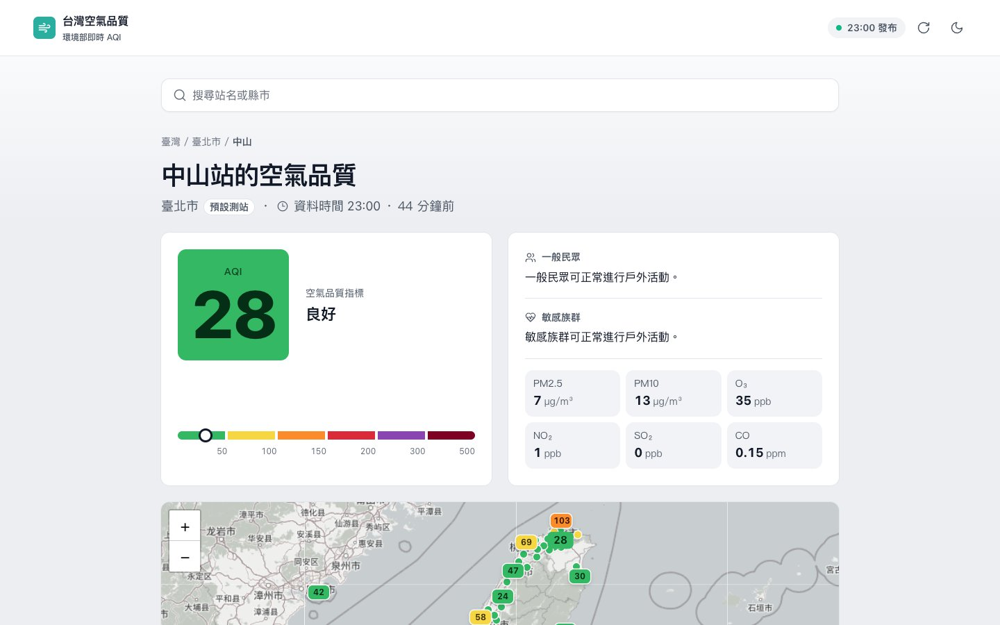
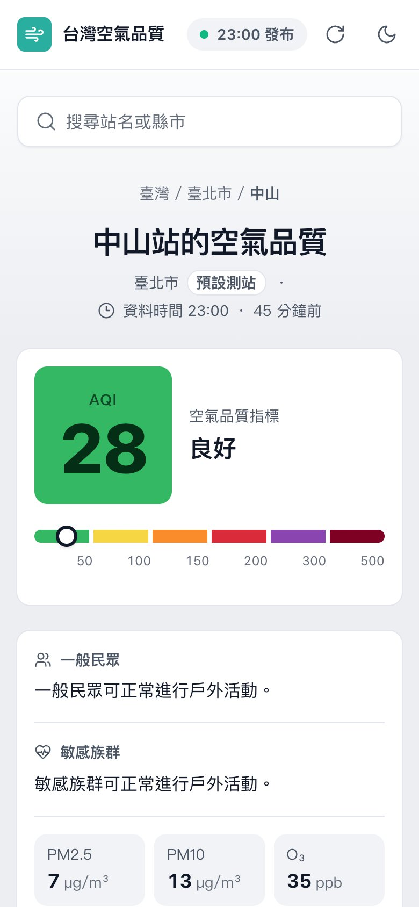

# 台灣空氣品質

搜尋你生活或活動區域的測站，查看環境部最新的 AQI、各污染物濃度，以及分別給一般民眾和敏感族群的活動建議；全台測站地圖每小時更新。資料時間永遠顯示在 AQI 旁邊，資料太舊時會明確標示，不會把舊資料當成現在的狀況。

**線上版：<https://livejiaquan.github.io/air-quality-monitor/>**

<p>
  
  
</p>

## 功能

- **我的測站**：輸入站名或縣市搜尋（「台」「臺」都找得到），選過的測站會記在瀏覽器，下次直接顯示。
- **AQI 一眼看懂**：依等級著色的大色塊、類別名稱和色階條同時呈現，不只靠顏色傳達。
- **全台地圖**：Leaflet 地圖上每個測站都是一個數字標記，重疊時只保留較重要的數字，其餘縮成小圓點。
- **排行與列表**：AQI 最高與最低的五個測站，以及可依縣市篩選、依 AQI 排序的完整測站列表。
- **資料時效**：從環境部的發布時間算起，分成即時、稍舊、過舊、無法使用四段，在瀏覽器端依現在時間計算。
- **深淺色模式**：預設淺色，可手動切換。

## 資料來源與授權

資料來自環境部環境資料開放平臺的[空氣品質指標（AQX_P_432）](https://data.moenv.gov.tw/dataset/detail/AQX_P_432)，依[政府資料開放授權條款第 1 版](https://data.gov.tw/license)再利用；地圖底圖 © OpenStreetMap 貢獻者。本站不是環境部官方網站，即時資料未經品保，健康提示依環境部現行的 AQI 活動建議精簡整理，僅供生活參考，不是醫療建議。

程式碼採 [MIT License](./LICENSE)。

## 本機執行

需要 Node.js 22。

```bash
npm ci
npm run dev
```

接著打開終端機顯示的網址。repo 內附一份驗證過的資料快照（`public/data/aqi-latest.json`），資料變舊時畫面會依序顯示稍舊、過舊的標示，這是預期行為。其他可重現的狀態：`/?demo=loading`、`/?demo=empty`、`/?demo=error`。

要抓最新資料，需要[向環境部申請](https://data.moenv.gov.tw/) API key：

```bash
MOENV_API_KEY=你的key npm run fetch:aqi
```

這個指令會驗證資料，通過才寫入快照；失敗時保留原本的檔案。

常用指令：

```bash
npm run lint && npm run typecheck && npm run test && npm run build
npm run validate:aqi   # 驗證 public/data/aqi-latest.json
```

## 專案結構

```
src/
  App.tsx              頁面組合、資料載入與更新
  components/          介面元件（測站搜尋、AQI 焦點卡、地圖、列表、排行等）
  lib/                 AQI 分級與資料正規化、時效計算、色票、標記避讓等
scripts/               抓取與驗證環境部資料的腳本（含測試）
public/                favicon、品牌標記與資料快照
docs/design-notes.md   設計取捨筆記
.github/workflows/     CI 與部署
```

技術：Vite、React 19、TypeScript、Tailwind CSS、Leaflet、Lucide 圖示、Vitest。

## 部署

`.github/workflows/deploy.yml` 在 push 到 main、手動觸發或排程時執行：用 repository secret `MOENV_API_KEY`（舊的 `API_KEY` 名稱也能用）在伺服器端抓資料、驗證、跑 lint 與測試、build，最後部署到 GitHub Pages。資料只存在部署產物中，不會寫回 repo，API key 也不會進入前端。任何一步失敗都不會部署，線上維持上一版。`.github/workflows/ci.yml` 在 pull request 時只跑檢查，不使用 secret。
