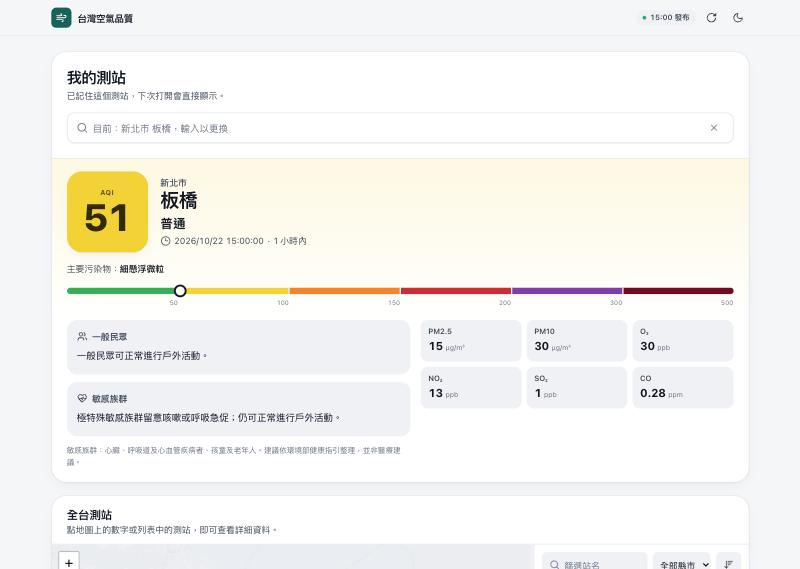
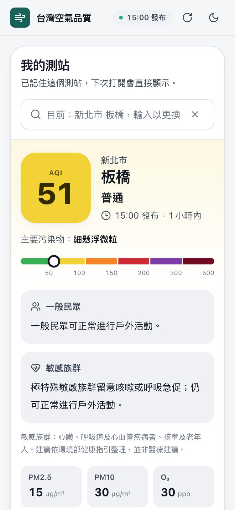

# 台灣空氣品質 · Taiwan AQI

**線上版：<https://livejiaquan.github.io/air-quality-monitor/>**

搜尋你生活或活動區域的測站，就能看到環境部最新 AQI、各污染物濃度，以及分開給一般民眾和敏感族群的活動建議；全台測站地圖每小時更新。資料過期時會清楚標示，並暫停「現在」的結論，不會用舊資料假裝即時。

<p>
  
  
</p>

## 功能

- **我的測站**：輸入站名或縣市即可搜尋（「台／臺」都能用），選過的測站會記住，下次打開直接顯示。
- **大數字＋類別＋色階條**：AQI 數字、官方類別名稱和六段色階條同時呈現，顏色不是唯一線索，色盲使用者也能判讀。
- **全台地圖與列表**：Leaflet 地圖上每個測站都是一顆數字標記；手機可切換地圖／列表，桌面兩者並排。
- **資料時效**：頁首顯示最新發布時間；超過 3 小時的測站改成灰色虛線樣式，並排除於排行與建議之外。
- **深淺色模式**：預設跟隨系統，也可以手動切換。
- **全台概況**：類別分布與各縣市最高值，只計算有效且新鮮的測站。

設計研究（環境部監測網、IQAir、aqicn、PurpleAir、AirNow 等產品比較，以及採用的取捨）見 [docs/design-research.md](./docs/design-research.md)。

## 架構

```
MOENV AQX_P_432 ──(GitHub Actions，server-side，帶 secret)──▶ scripts/fetch-aqi.mjs
                                                              │ 欄位白名單＋production contract 驗證
                                                              ▼
                                               public/data/aqi-latest.json（只存在 build 產物中）
                                                              │
                                    Vite build ──▶ dist/ ──▶ GitHub Pages（純靜態）
```

- **前端**：Vite、React 19、TypeScript、Tailwind CSS、Leaflet（OpenStreetMap 圖磚）、lucide 圖示。
- **API key 不會進前端**：瀏覽器只讀取同站的靜態 JSON；key 只存在 Actions secret，部署前會掃描 `dist/`，確認沒有任何憑證字串。
- **Fail-closed**：抓取、驗證、lint、測試或 build 任一步失敗都不部署，線上保留上一版；前端也會逐站重新計算時效。
- **不產生 bot commit**：每次部署都是在 workflow 內即時抓資料，快取不再 commit 回 repo。

### 資料可信度契約

`scripts/aqi-cache-contract.mjs` 在寫入快取前會檢查以下條件，並有完整測試：

- 至少 80 個有效測站，涵蓋 22 個縣市，有效比例至少 95%。
- `siteid` 不重複；AQI 為 0–500 的整數。
- 發布時間依 Asia/Taipei 解析，不得超過 3 小時，也不得超前現在 15 分鐘以上。
- 缺值保留為空，不轉成 0；全體或單站的發布時間倒退都會拒絕。

健康提示依環境部 2025-01-01 起的[現行 AQI 健康影響與活動建議](https://airtw.moenv.gov.tw/CHT/Information/Standard/AirQualityIndicatorNew.aspx#Health)精簡整理，不是醫療建議。即時資料未經品保，正式引用請使用環境部品保後的資料。

## 本機開發

需要 Node.js 22：

```bash
npm ci
npm run dev
```

repo 內附一份已通過驗證的快照（`public/data/aqi-latest.json`），超過 3 小時後畫面會進入「資料過期」狀態，這是預期行為。其他可重現的展示狀態：`/?demo=loading`、`/?demo=empty`、`/?demo=error`。

用自己的 key 抓最新資料（[向環境部申請](https://data.moenv.gov.tw/)）：

```bash
MOENV_API_KEY=your-key npm run fetch:aqi
```

驗證：

```bash
npm run lint && npm run typecheck && npm run test && npm run build
```

## 部署

- `.github/workflows/deploy.yml`：在 push main、手動觸發或排程（每小時兩次）時執行，流程是抓資料、驗證、測試、build，最後部署到 GitHub Pages。需要在 repository secret 設定 `MOENV_API_KEY`（舊的 `API_KEY` 名稱也能用）。
- `.github/workflows/ci.yml`：PR 時跑 lint、typecheck、test 和 build，不使用任何 secret。

## 授權與資料顯名

程式碼採 [MIT License](./LICENSE)。資料來源為環境部「[空氣品質指標（AQX_P_432）](https://data.moenv.gov.tw/dataset/detail/AQX_P_432)」，依[政府資料開放授權條款第 1 版](https://data.gov.tw/license)再利用；底圖 © OpenStreetMap 貢獻者。本站不是環境部官方網站。
